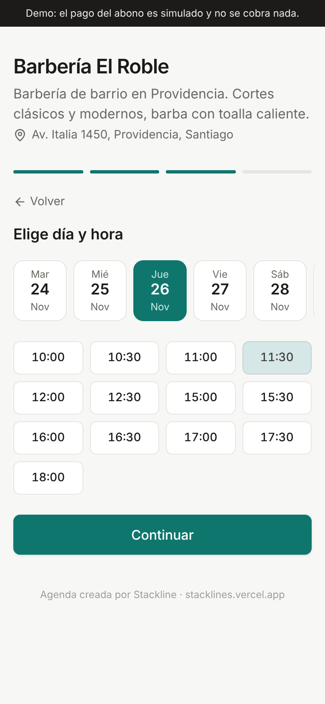
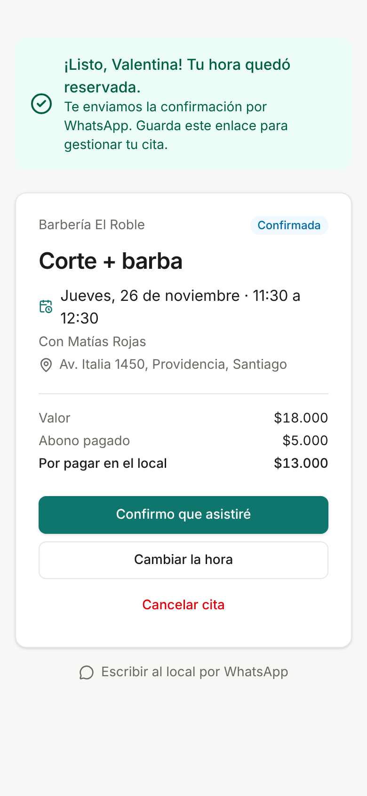
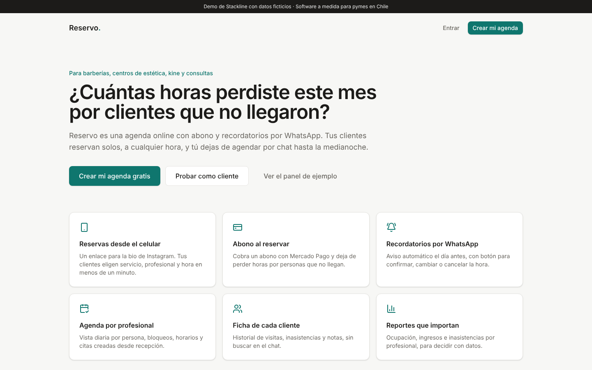
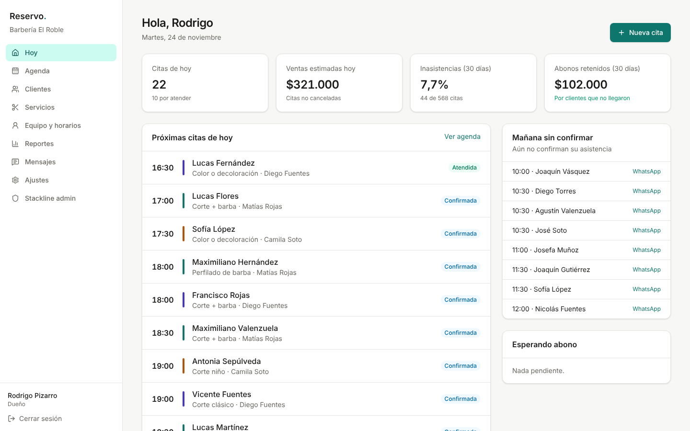
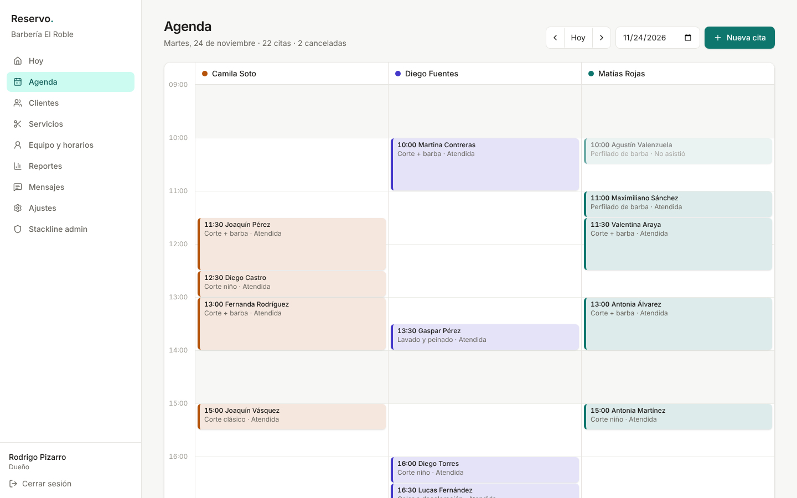
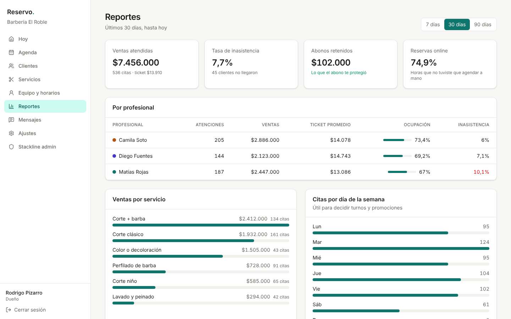
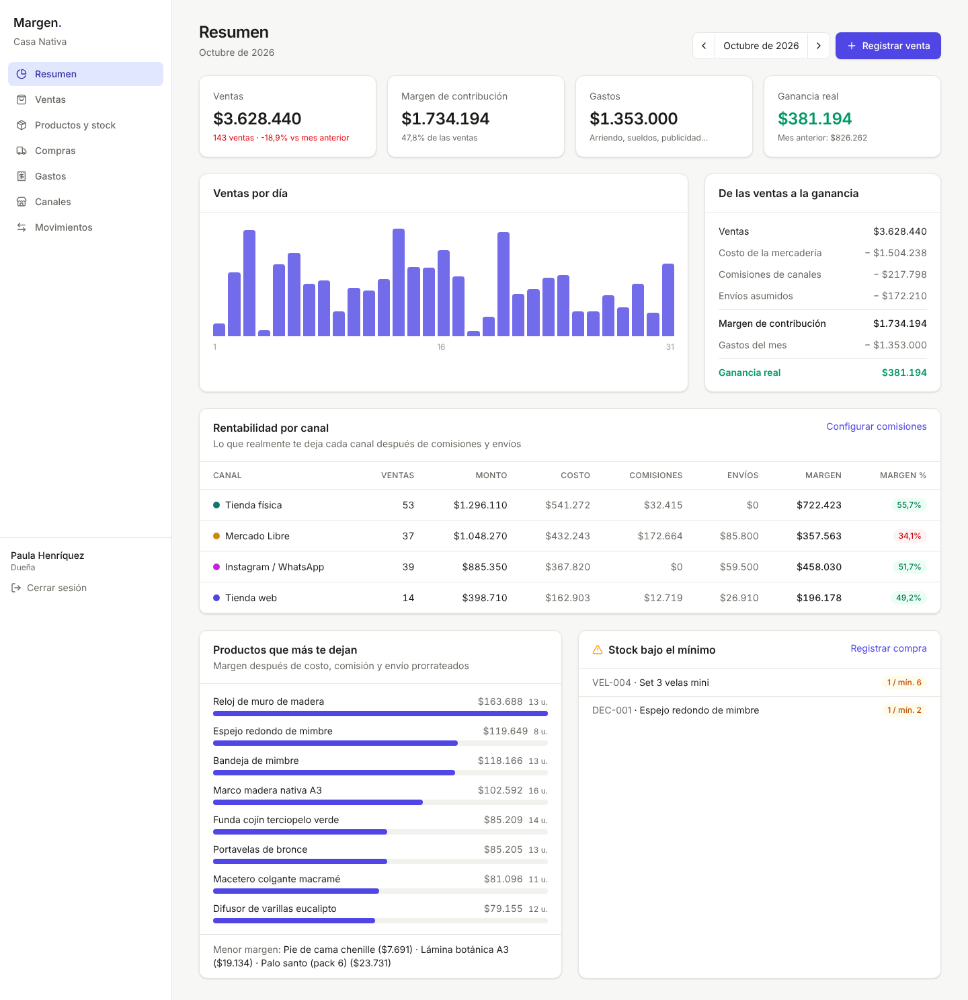
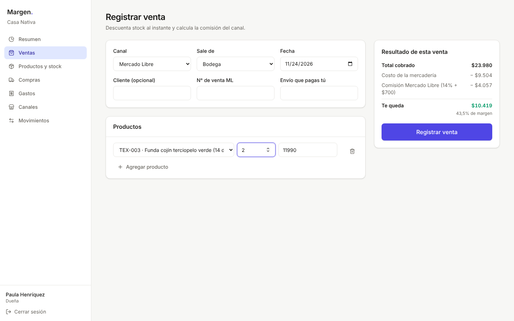
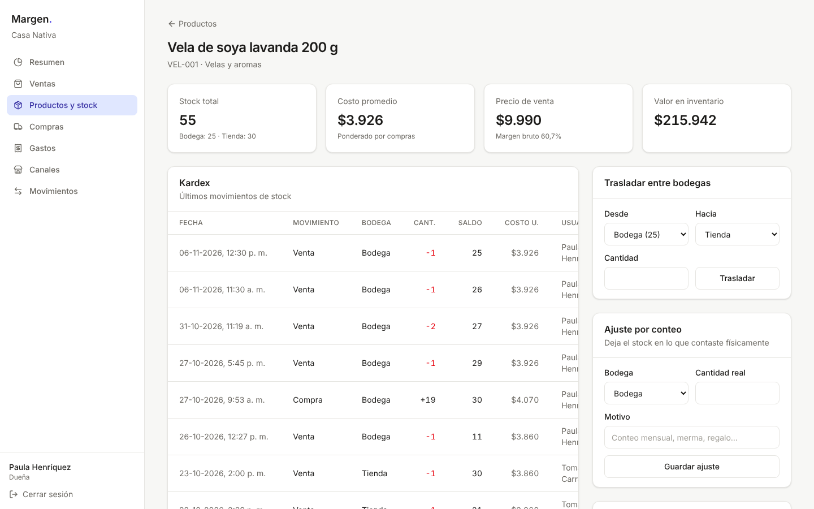

# Stackline · Demos para el portafolio

Proyectos de demostración de [Stackline](https://stacklines.vercel.app/) pensados para mostrar a pymes que llegan por redes y publicidad. Cada demo es una app completa y navegable, con datos ficticios realistas de un rubro, que se puede adaptar a un cliente real.

| Demo | Para quién | Qué muestra |
|---|---|---|
| [`apps/agenda`](apps/agenda) · **Reservo** | Barberías, centros de estética, kine, consultas | Reserva online con abono, recordatorios por WhatsApp, gestión de la cita por el cliente, agenda por profesional y reportes de inasistencia |
| [`apps/inventario`](apps/inventario) · **Margen** | Pymes que venden en local, Instagram y Mercado Libre | Stock por bodega, costo promedio ponderado, comisiones por canal, gastos y ganancia real del mes |

## Cómo se ve

> Guía para presentarlas a un cliente: [docs/guia-demo.md](docs/guia-demo.md)

### Reservo (agenda online)

| Reserva desde el celular | Gestión de la cita |
|---|---|
|  |  |






### Margen (inventario multicanal)





## Probar en local

Requisitos: Node 20 o superior y pnpm 10.

```bash
pnpm install
pnpm dev:agenda       # http://localhost:3001
pnpm dev:inventario   # http://localhost:3002
```

No hace falta instalar Postgres: sin `DATABASE_URL`, cada app usa [PGlite](https://pglite.dev) (Postgres embebido) en `apps/<app>/.data/` y carga los datos de demostración la primera vez. Para empezar de cero, borra esa carpeta (`pnpm --filter agenda db:reset`).

En la pantalla de login hay botones para entrar con un clic como dueño o como personal. Las cuentas de demostración usan `dueno@demo.cl` y la contraseña `demo1234` (definidas en `src/db/seed.ts` de cada app).

## Reservo como SaaS (muchos negocios en una instalación)

La agenda funciona como servicio para muchos locales a la vez:

- **Registro** en `/registro`: el dueño crea su negocio, elige el rubro y parte con servicios de ejemplo, un horario base y 14 días de prueba gratis.
- **Enlace propio** por negocio: `/reservar/<enlace>`, editable en *Ajustes* junto con la descripción, dirección, WhatsApp, color de marca y horas mínimas para cancelar.
- **Guía de primeros pasos** en el panel hasta que el negocio queda configurado.
- **Equipo**: el dueño invita usuarios por enlace (rol recepción o administrador). Una persona puede pertenecer a varios negocios y cambiar entre ellos en *Ajustes*.
- **Aislamiento**: todas las consultas del panel filtran por el negocio de la sesión (`org_id`).
- **Administración de Stackline** en `/admin` (solo correos de `SUPERADMIN_EMAILS`): lista de negocios, uso, plan, extender prueba y suspender.

Pendiente para cobrar: conectar la suscripción mensual (por ejemplo, suscripciones de Mercado Pago), correos transaccionales (bienvenida, recuperar contraseña) y límites por plan.

### Camino a Supabase

Hoy la base puede ser cualquier Postgres, incluido el de Supabase (`DATABASE_URL`). El siguiente paso sería usar Supabase Auth para el login (recuperar contraseña, entrar con Google, confirmar correo) y políticas RLS por `org_id` como segunda capa de seguridad. El modelo de datos ya está preparado para eso: cada tabla de negocio tiene `org_id` y los permisos salen de `memberships`.

## Estructura

```
packages/core     Base común: conexión a la base, sesiones y roles, auditoría,
                  formatos chilenos (CLP, fechas), zona horaria y componentes UI
apps/agenda       Next.js · demo de agenda online
apps/inventario   Next.js · demo de inventario multicanal
```

Stack: Next.js 16 (App Router, server actions), React 19, TypeScript, Tailwind CSS 4, Drizzle ORM sobre Postgres, Zod.

Todo es multiempresa desde el inicio: cada tabla de negocio tiene `org_id`, los usuarios tienen rol (`owner`, `admin`, `staff`) por empresa, y las acciones que cambian datos quedan en `audit_log`.

## Desplegar en Vercel

Cada app se despliega como un proyecto de Vercel aparte, con **Root Directory** `apps/agenda` o `apps/inventario`.

1. Crea una base Postgres (Supabase o Neon) por app y copia la URL de conexión.
2. En Vercel, define las variables de entorno de `.env.example` de la app. Como mínimo `DATABASE_URL`, `CRON_SECRET` y, para la demo pública, `DEMO_MODE=true`.
3. Las migraciones se aplican solas en el primer request. `vercel.json` programa los cron de la agenda: recordatorios una vez al día (9:00 de Chile, cubre las citas de las 26 horas siguientes) y reinicio diario de los datos de demostración.

> Se dejaron diarios porque el plan Hobby de Vercel no permite cron más frecuentes. Con el plan Pro se puede cambiar el de recordatorios a cada hora (`0 * * * *`) para avisar más cerca de la cita.

### Integraciones de la agenda

- **Abonos con Mercado Pago:** con `MERCADOPAGO_ACCESS_TOKEN` se crea una preferencia de Checkout Pro y el webhook `/api/webhooks/mercadopago` confirma la cita consultando el pago a la API. Sin token, el pago se simula en `/pago-simulado/...`.
- **WhatsApp Cloud API:** con `WHATSAPP_TOKEN` y `WHATSAPP_PHONE_NUMBER_ID` se envían los mensajes. Para recordatorios fuera de la ventana de 24 horas Meta exige una plantilla aprobada (`WHATSAPP_TEMPLATE`, con tres parámetros: nombre, fecha y hora, enlace). Sin credenciales, los mensajes quedan registrados como simulados en el panel.

Estas dos integraciones están implementadas según la documentación pública, pero no se han probado contra cuentas reales. Hay que validarlas con credenciales de prueba antes de usarlas con un cliente.

## Cambiar el esquema

```bash
# edita apps/<app>/src/db/schema.ts y luego:
pnpm --filter <app> db:generate
```

## Ideas para la siguiente versión

- Agenda: pago del saldo en el local, lista de espera, varias sucursales, Google Calendar del profesional.
- Inventario: sincronización de stock y ventas con la API de Mercado Libre, conexión con facturación electrónica (Bsale, Defontana u otro), lector de código de barras.
